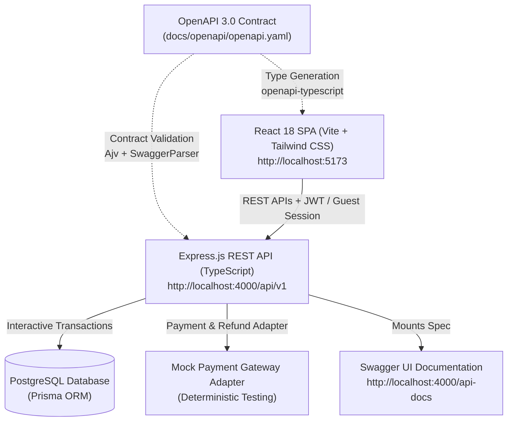

# BookWorm E-Commerce Platform

[](https://nodejs.org/)
[](https://www.typescriptlang.org/)
[](https://expressjs.com/)
[](https://react.dev/)
[](https://www.prisma.io/)
[](https://tailwindcss.com/)
[](https://swagger.io/specification/)

**BookWorm** is a full-stack, spec-driven online bookstore e-commerce application. It delivers an end-to-end purchasing experience featuring catalog browsing, book reviews, guest and member shopping carts, wishlist management, checkout orchestration with real-time pincode shipping calculations and coupon validation, deterministic mock payment processing, and comprehensive order lifecycle tracking.

The project is architected with a **Spec-Driven Development (SDD)** methodology using OpenAPI 3.0 as the single source of truth across both the backend REST services and the frontend React SPA.

---

## Table of Contents

1. [System Architecture & Design](#system-architecture--design)
2. [Key Features](#key-features)
3. [Tech Stack](#tech-stack)
4. [Project Structure](#project-structure)
5. [Getting Started & Local Setup](#getting-started--local-setup)
   - [Prerequisites](#prerequisites)
   - [1. Backend Setup](#1-backend-setup)
   - [2. Frontend Setup](#2-frontend-setup)
6. [Demo Accounts & Test Data](#demo-accounts--test-data)
7. [API Specification & Endpoints](#api-specification--endpoints)
8. [Testing & Validation](#testing--validation)
9. [Documentation Reference](#documentation-reference)

---

## System Architecture & Design



### Architectural Principles
- **Spec-Driven Single Source of Truth:** All API schemas, parameter constraints, and status codes are contractually defined in [`docs/openapi/openapi.yaml`](docs/openapi/openapi.yaml).
- **Layered Modular Backend:** Each domain module contains dedicated routes, controllers, services, and Zod schemas (`backend/src/modules/*`).
- **Data Integrity & Idempotency:** Critical write operations (order creation, stock reservation, payment confirmation) execute inside atomic `prisma.$transaction` blocks with idempotency key enforcement (`Idempotency-Key`).
- **RFC 7807 Problem Details:** All API errors adhere to the RFC 7807 standard (`{ status, title, detail, errors, timestamp }`).
- **Adapter-Based Payments:** Pluggable `PaymentGatewayAdapter` decoupling payment orchestration from gateway-specific logic with deterministic test modes.

---

## Key Features

### 1. Catalog & Discovery
- **Hierarchical Categories:** Recursive category tree browsing with parent-child relationship support.
- **Search & Filtering:** Multi-faceted search by keyword (`q`), category slug, author, publisher, format, language, and price ranges.
- **Featured Curation:** Sections for "Recommended for You", "Bestsellers this Month", and "New Launches".
- **Product Detail Page (PDP):** Comprehensive book details, front & back covers, stock availability, author biography, and deterministic related recommendations.
- **Verified Reviews & Ratings:** Star ratings and reviews tied to user purchases with real-time aggregate rating updates.

### 2. Cart & Wishlist
- **Guest Sessions:** Anonymous cart creation and persistence using `x-guest-session-id`.
- **Atomic Cart Merge:** Seamlessly transfers and merges guest cart items into the customer account upon login/registration.
- **Inventory Validation:** Real-time stock reservation and checks preventing overselling.
- **Wishlist:** Authenticated wishlist with one-click atomic move-to-cart operations.

### 3. Checkout & Shipping Engine
- **Address Management:** Multiple delivery addresses per user with default address selection and 6-digit postal code validation.
- **Shipping Calculator:** Zone-based shipping calculation for `STANDARD` and `EXPRESS` tiers with free-shipping order thresholds and delivery date estimation.
- **Coupons & Rewards:** Percentage (`WELCOME10`) and fixed-discount (`FLAT50`) coupon validation alongside loyalty reward points redemption.
- **Preview Summary:** Single source pricing calculation for subtotal, tax (2%), shipping, discounts, and payable total.

### 4. Mock Payment Gateway
- **Multi-Method Support:** Credit Card, Debit Card, UPI, and Wallet simulation.
- **Deterministic Outcomes:**
  - Card ending with `0000` $\rightarrow$ `PAYMENT_FAILED` / `DECLINED`
  - Card ending with `9999` $\rightarrow$ `INSUFFICIENT_FUNDS`
  - Valid card / UPI / Wallet $\rightarrow$ `SUCCESS` with reference `MOCK_TXN_<uuid>`
- **Idempotent Confirmation:** Safe retries on payment failures without duplicating orders or inventory leaks.
- **PCI Compliance Safety:** PAN, CVV, and raw card details are never persisted.

### 5. Order Lifecycle & Fulfillment
- **State Machine:** Transitions through `PAYMENT_PENDING` $\rightarrow$ `CONFIRMED` $\rightarrow$ `PROCESSING` $\rightarrow$ `SHIPPED` $\rightarrow$ `DELIVERED` (or `CANCELLED` / `RETURNED` / `REFUNDED`).
- **Customer Actions:** Order cancellation (with automatic stock release and refund), 7-day return requests, shipment milestone tracking, and "Buy Again" re-ordering.
- **Role-Based Operations:** Fulfillment and Admin controls for status progression and refunds.

---

## Tech Stack

| Layer | Technology | Description |
| :--- | :--- | :--- |
| **Backend Framework** | Node.js (v20+) & Express.js (v4.21) | RESTful API server with modular architecture |
| **Language** | TypeScript (v5.5+ / v5.9+) | Strict typing, interfaces, and zero-any policy |
| **Database & ORM** | PostgreSQL & Prisma ORM (v6.0) | Schema migrations, relations, and transactional queries |
| **Validation** | Zod (v3.23) | Request body, query parameter, and route validation |
| **Security & Auth** | JWT (`jsonwebtoken`), `bcryptjs`, Helmet, CORS, Rate Limit | Stateless tokens, SHA-256 hashed refresh rotation |
| **Frontend SPA** | React (v18.3), Vite (v6), React Router (v6.30) | High-performance single page application |
| **State & Server Cache** | TanStack Query (v5) & Zustand (v4.5) | Server state synchronization and client auth stores |
| **UI & Styling** | Tailwind CSS (v3.4), React Hook Form | Dark book-themed palette and accessible form handling |
| **Testing** | Jest, Vitest, Supertest, React Testing Library, MSW | Unit, integration, contract, and end-to-end tests |
| **Contract** | OpenAPI 3.0.3, Swagger UI, `openapi-typescript` | Live documentation and automated TypeScript typegen |

---

## Project Structure

```
capstone-project/
├── AGENTS.md                         # Context & rules for AI assistants
├── backend-architecture-plan.md      # Backend technical & architectural specification
├── frontend-plan.md                  # Frontend implementation plan & wireframe specs
├── docs/                             # Documentation, architecture, and contracts
│   ├── openapi/
│   │   └── openapi.yaml              # Single source of truth OpenAPI 3.0 specification
│   ├── wireframes/                   # UI reference wireframes (Images 1-6)
│   ├── architecture.png              # High-level architecture diagram
│   ├── development-log.md            # Backend build & implementation log
│   └── local-database-setup-guide.md # Local PostgreSQL & DBeaver guide
├── backend/                          # Express.js REST API
│   ├── src/
│   │   ├── app.ts                    # Express app configuration & middlewares
│   │   ├── server.ts                 # Server entry point
│   │   ├── config/                   # Prisma client, env config, OpenAPI loader
│   │   ├── middlewares/              # Auth, validation, error handler, rate limiter
│   │   ├── modules/
│   │   │   ├── member/               # Auth, profile, and address management
│   │   │   ├── catalog/              # Books, categories, authors, reviews
│   │   │   ├── cart/                 # Cart, guest session, and wishlist
│   │   │   ├── order/                # Orders, lifecycle state machine, checkout
│   │   │   ├── payment/              # Payment service & mock adapter
│   │   │   └── shipping/             # Shipping rates, zones, delivery estimates
│   │   └── utils/                    # Money calculations, logger, HTTP errors
│   ├── prisma/
│   │   ├── schema.prisma             # Relational data model definitions
│   │   ├── migrations/               # Versioned SQL migrations & check constraints
│   │   └── seed.ts                   # Database seed script (catalog, users, rates)
│   ├── tests/                        # Jest & Supertest integration & contract test suites
│   ├── package.json
│   └── tsconfig.json
└── frontend/                         # React 18 SPA
    ├── src/
    │   ├── api/                      # Typed HTTP client, endpoint modules, schema.d.ts
    │   ├── components/               # UI primitives, layout, catalog, cart components
    │   ├── hooks/                    # TanStack Query & filter hooks
    │   ├── pages/                    # Route pages (Home, Browse, PDP, Cart, Wishlist, Auth)
    │   ├── schemas/                  # Zod form validation schemas
    │   ├── stores/                   # Zustand stores (Auth, Guest Session, Toast)
    │   ├── utils/                    # Currency formatting (INR), error mappers
    │   ├── router.tsx                # React Router route configuration
    │   ├── main.tsx                  # Application entry point
    │   └── test/                     # MSW mock handlers & test utilities
    ├── package.json
    ├── vite.config.ts
    └── tailwind.config.ts
```

---

## Getting Started & Local Setup

### Prerequisites
- **Node.js:** v20.x or v22.x LTS ([Download Node.js](https://nodejs.org/))
- **npm:** v10.x+
- **PostgreSQL Database:** (Local PostgreSQL instance or Docker container; an embedded PostgreSQL runner is also included for zero-dependency local development)

---

### 1. Backend Setup

1. **Navigate to the backend directory:**
   ```powershell
   cd backend
   ```

2. **Install dependencies:**
   ```powershell
   npm install
   ```

3. **Configure Environment Variables:**
   Copy `.env.example` to `.env`:
   ```powershell
   Copy-Item .env.example .env
   ```
   *Default configuration uses `http://localhost:4000` with PostgreSQL on port `5432`.*

4. **Initialize Database & Seed Data:**

   *Option A: Embedded PostgreSQL (No PostgreSQL installation required)*
   ```powershell
   # Terminal 1: Start the embedded PostgreSQL server
   npm run db:dev

   # Terminal 2: Run migrations and seed
   npm run prisma:deploy
   npm run prisma:seed
   ```

   *Option B: Existing PostgreSQL / Docker Instance*
   ```powershell
   # Ensure PostgreSQL is running on port 5432 with database 'bookworm_db'
   npm run prisma:deploy
   npm run prisma:seed
   ```

5. **Start Backend Development Server:**
   ```powershell
   npm run dev
   ```
   - **API Server:** [http://localhost:4000/api/v1](http://localhost:4000/api/v1)
   - **Swagger UI Interactive Documentation:** [http://localhost:4000/api-docs](http://localhost:4000/api-docs)
   - **Health Check:** [http://localhost:4000/health](http://localhost:4000/health)

---

### 2. Frontend Setup

1. **Navigate to the frontend directory:**
   ```powershell
   cd frontend
   ```

2. **Install dependencies:**
   ```powershell
   npm install
   ```

3. **Configure Environment Variables:**
   Copy `.env.example` to `.env`:
   ```powershell
   Copy-Item .env.example .env
   ```
   *The default configuration sets `VITE_API_BASE_URL=/api/v1`, using Vite's built-in proxy forwarding to `http://localhost:4000`.*

4. **Start Frontend Development Server:**
   ```powershell
   npm run dev
   ```
   - **Storefront Application:** [http://localhost:5173](http://localhost:5173)

---

## Demo Accounts & Test Data

All seeded test accounts share the same default password:

> **Password:** `Password@123`

| Email | Role | Capabilities |
| :--- | :--- | :--- |
| `customer@bookworm.test` | `ROLE_CUSTOMER` | Browse catalog, manage cart/wishlist, checkout, submit reviews, order management |
| `catalog@bookworm.test` | `ROLE_CATALOG_ADMIN` | Create, update, and manage books and categories |
| `fulfillment@bookworm.test`| `ROLE_FULFILLMENT` | Update order shipment status (`SHIPPED`, `DELIVERED`) |
| `admin@bookworm.test` | `ROLE_SYSTEM_ADMIN` | System-wide operations, order cancellations, process refunds |

### Test Payment Instruments
- **Declined Card Simulation:** Use any valid 16-digit card ending in `0000` (e.g. `4111 1111 1111 0000`).
- **Insufficient Funds Simulation:** Use any card ending in `9999` (e.g. `4111 1111 1111 9999`).
- **Successful Payment Simulation:** Any other 16-digit card (e.g. `4111 1111 1111 1111`, CVV `123`, Expiry `12/28`), valid UPI (e.g. `user@okhdfcbank`), or Wallet.

### Available Discount Coupons
- `WELCOME10`: 10% discount on orders above ₹200 (max discount ₹100).
- `FLAT50`: Flat ₹50 discount on orders above ₹300.

### Serviceable Pincodes
- `560001`, `560100` (Bengaluru - South Zone)
- `400001` (Mumbai - West Zone)
- `110001` (Delhi - North Zone)
- `700001` (Kolkata - East Zone)
- `600001` (Chennai - South Zone)
- `500001` (Hyderabad - South Zone)
- `380001` (Ahmedabad - West Zone)
- `795001` (Imphal - North East Zone)

---

## API Specification & Endpoints

The complete OpenAPI 3.0 specification is available at [`docs/openapi/openapi.yaml`](docs/openapi/openapi.yaml) and interactive Swagger UI is served at `/api-docs`.

### Summary of REST Endpoints

| Domain | Method | Endpoint | Description | Auth Required |
| :--- | :--- | :--- | :--- | :--- |
| **System** | `GET` | `/health` | Server liveness probe | No |
| **Auth** | `POST` | `/api/v1/auth/register` | Register customer account | No |
| | `POST` | `/api/v1/auth/login` | Authenticate and obtain JWT token pair | No |
| | `POST` | `/api/v1/auth/refresh` | Rotate access token with refresh token | No |
| | `POST` | `/api/v1/auth/logout` | Revoke active refresh token | Yes |
| **Members** | `GET` | `/api/v1/members/me` | Retrieve profile and reward points | Yes |
| | `PATCH` | `/api/v1/members/me` | Update name or phone number | Yes |
| | `GET` | `/api/v1/members/me/addresses` | List saved shipping addresses | Yes |
| | `POST` | `/api/v1/members/me/addresses` | Add new shipping address | Yes |
| | `DELETE`| `/api/v1/members/me/addresses/{id}` | Delete saved address | Yes |
| **Catalog** | `GET` | `/api/v1/catalog/books` | Search and filter books (paginated) | No |
| | `GET` | `/api/v1/catalog/books/{id}` | Get book details by ID | No |
| | `GET` | `/api/v1/catalog/featured` | Fetch featured, bestseller, and new launches | No |
| | `GET` | `/api/v1/catalog/books/{id}/related` | Get related book recommendations | No |
| | `GET` | `/api/v1/catalog/books/{id}/reviews` | List customer reviews for a book | No |
| | `POST` | `/api/v1/catalog/books/{id}/reviews` | Submit verified customer review | Yes |
| | `GET` | `/api/v1/categories` | Retrieve hierarchical category tree | No |
| | `GET` | `/api/v1/authors/{id}` | Get author profile and books | No |
| **Cart** | `GET` | `/api/v1/cart` | Get cart (guest via header or member JWT) | No / Optional |
| | `POST` | `/api/v1/cart/items` | Add book to cart | No / Optional |
| | `PATCH` | `/api/v1/cart/items/{itemId}` | Update cart item quantity | No / Optional |
| | `DELETE`| `/api/v1/cart/items/{itemId}` | Remove item from cart | No / Optional |
| | `POST` | `/api/v1/cart/merge` | Merge guest cart into customer cart | Yes |
| **Wishlist** | `GET` | `/api/v1/wishlist` | View member wishlist | Yes |
| | `POST` | `/api/v1/wishlist/items` | Add book to wishlist | Yes |
| | `DELETE`| `/api/v1/wishlist/items/{bookId}`| Remove book from wishlist | Yes |
| | `POST` | `/api/v1/wishlist/items/{bookId}/move-to-cart` | Atomically move book to cart | Yes |
| **Checkout** | `POST` | `/api/v1/orders/checkout/summary` | Preview pricing, taxes, shipping & totals | No / Optional |
| | `POST` | `/api/v1/coupons/validate` | Check coupon validity and discount value | Yes |
| | `POST` | `/api/v1/shipping/calculate-rate` | Calculate shipping rate by pincode and tier | No |
| **Orders** | `POST` | `/api/v1/orders` | Create order (`Idempotency-Key` required) | Yes |
| | `GET` | `/api/v1/orders` | List customer orders (paginated) | Yes |
| | `GET` | `/api/v1/orders/{id}` | Get complete order details | Yes |
| | `POST` | `/api/v1/orders/{id}/cancel` | Cancel order before shipment | Yes |
| | `POST` | `/api/v1/orders/{id}/return` | Initiate 7-day return request | Yes |
| | `POST` | `/api/v1/orders/{id}/buy-again`| Re-add order items to cart | Yes |
| | `PATCH` | `/api/v1/orders/{id}/status` | Update fulfillment state (Staff only) | Yes (Staff) |
| **Payments** | `POST` | `/api/v1/payments/initiate` | Initiate mock payment transaction | Yes |
| | `POST` | `/api/v1/payments/confirm` | Confirm payment outcome | Yes |
| | `POST` | `/api/v1/payments/refund` | Process full/partial refund (Admin only) | Yes (Admin) |
| **Shipping** | `GET` | `/api/v1/shipping/track/{trackingNumber}` | Get shipment milestones & status | No |

---

## Testing & Validation

### Backend Testing (Jest & Supertest)
The backend test suite includes full integration testing across auth, catalog, cart, orders, payments, shipping, and contract verification against the OpenAPI YAML specification.

```powershell
cd backend

# Run all test suites
npm test

# Run tests with coverage report
npm run test:coverage

# Perform TypeScript type-checking
npm run typecheck
```

### Frontend Testing (Vitest, React Testing Library & MSW)
The frontend uses Mock Service Worker (MSW) to validate client state, routing, and UI interactions against mock responses conforming to the OpenAPI contract.

```powershell
cd frontend

# Run frontend tests
npm test

# Run tests in watch mode
npm run test:watch

# Run ESLint validation
npm run lint

# Regenerate TypeScript API types from OpenAPI spec
npm run gen:api
```

---

## Documentation Reference

- [`docs/openapi/openapi.yaml`](docs/openapi/openapi.yaml): OpenAPI 3.0 contract specification
- [`backend-architecture-plan.md`](backend-architecture-plan.md): Backend architecture & domain specification
- [`frontend-plan.md`](frontend-plan.md): Frontend implementation plan & wireframe mapping
- [`docs/development-log.md`](docs/development-log.md): Implementation history & engineering decisions
- [`docs/local-database-setup-guide.md`](docs/local-database-setup-guide.md): Local PostgreSQL and DBeaver configuration guide
- [`docs/wireframes/`](docs/wireframes/): UI wireframe specifications (Images 1–6)

---

## License

This project is licensed under the MIT License - see the [`LICENSE`](LICENSE) file for details.


frontend: `cd frontend && npm run dev` 
backend: 
`cd backend`
`npm run db:dev` -- terminal 1
`npm run prisma:deploy` -- terminal 2
`npm run prisma:generate` -- terminal 2
`npm run prisma:seed` -- terminal 2
`npm run dev` -- terminal 2