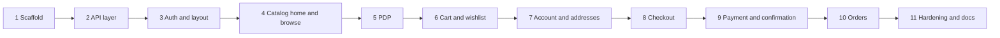

# BookWorm Frontend — Implementation Plan

## Top-Level Overview

**Goal:** Build the customer-facing BookWorm storefront as a React SPA in [`frontend/`](frontend/), following the wireframes in [`docs/wireframes/`](docs/wireframes/) (image1–6.png) and integrating the existing backend REST APIs defined in [`docs/openapi/openapi.yaml`](docs/openapi/openapi.yaml).

**Approach (Spec-Driven):** OpenAPI contract → generated TypeScript types → typed API client → Zod form schemas → TanStack Query hooks → pages/components → tests (MSW mocks derived from the contract).

**Confirmed tech stack:** Vite + React 18 + TypeScript (strict), React Router, TanStack Query, Zustand (auth + guest session), React Hook Form + Zod, Tailwind CSS, Vitest + React Testing Library + MSW, `openapi-typescript` for type generation.

**In scope:** browse/search/filter, category browsing, home sections, PDP + reviews + related, guest cart, wishlist, register/login/logout/refresh, profile + addresses, checkout (address, coupon, points, shipping tier), mock payment modal, order confirmation, order history/detail (cancel, return, buy-again, tracking).

**Out of scope:** admin/staff screens (book create/edit, order status updates, refunds, webhooks simulation), backend changes.

### Key contract facts (from `openapi.yaml`, `backend-architecture-plan.md`, `backend/src/app.ts`)
- Base URL `http://localhost:4000`, all routes under `/api/v1`. CORS exposes `x-guest-session-id` and `x-correlation-id`.
- Auth: JWT Bearer; `AuthResponse = { user, tokens{accessToken, refreshToken, expiresIn} }`; `/auth/refresh` and `/auth/logout` take `refreshToken`.
- Guests: cart and checkout summary work with `x-guest-session-id`; wishlist, addresses, orders, payments require JWT. `POST /cart/merge` merges guest cart after login.
- Errors: RFC 7807 `Problem` `{ status, title, detail, errors[{field,message}], timestamp }`.
- Pagination: `page`, `limit` → `{ data, pagination{page,limit,total,totalPages} }`.
- `POST /orders` requires `Idempotency-Key` (replay returns 200, new returns 201, status `PAYMENT_PENDING`). `POST /payments/initiate` accepts optional `Idempotency-Key`.
- Payment: card ending `0000` → HTTP 200 with `FAILED` outcome; any other valid instrument → `SUCCESS` (`MOCK_TXN_<uuid>`), order becomes `CONFIRMED`.
- Book search params: `q, category, authorId, publisher, format, language, minPrice, maxPrice, sort(relevance|price_asc|price_desc|publication_date|rating), page, limit`.

### Wireframe → screen mapping
| Wireframe | Screen | Primary endpoints |
|---|---|---|
| image1 | Home / browse: header (logo, search, My Orders, Wishlist, Cart, Profile), category sidebar, Recommended / Bestsellers / New Launches | `GET /catalog/featured`, `GET /categories`, `GET /catalog/books` |
| image2 | Category browse (same layout as image1; slide notes: select category, browse catalogue per category, select product, related products, Buy Again from order history) | `GET /catalog/books`, `GET /categories`, `POST /orders/{id}/buy-again` |
| image3 | PDP: covers, author bio, price, stock, rating, Add to Basket / Wishlist, related reads, reviews | `GET /catalog/books/{id}`, `/related`, `/reviews`, `GET /authors/{id}`, cart + wishlist |
| image4 | Cart + shipping address + Grand Total (price, tax, delivery, coupon, total), Proceed to Pay | `GET/PUT/DELETE /cart`, addresses, `POST /coupons/validate`, `POST /orders/checkout/summary`, `POST /shipping/calculate-rate` |
| image5 | Payment modal (Credit Card / Debit Card / UPI / Wallet tabs, card number, name on card, CVV, expiry, Payable Amount, Pay Now) | `POST /payments/initiate`, `POST /payments/confirm` |
| image6 | Order confirmation modal (success, purchased books, Continue Shopping) | `GET /orders/{id}` |

> Note: the mapping above was corrected after viewing the images (the original explorer summary had image2 and image5 swapped). Verified: image1 landing, image2 category browse, image3 PDP, image4 cart + address + Grand Total, image5 payment modal, image6 order confirmation.

### Target folder structure (under `frontend/`)
```
frontend/
├── package.json, tsconfig.json, vite.config.ts, tailwind.config.ts, postcss.config.js, index.html, .env.example
├── src/
│   ├── main.tsx, App.tsx, router.tsx
│   ├── api/            # generated types (schema.d.ts), http client, per-domain endpoint modules
│   ├── hooks/          # TanStack Query hooks per domain
│   ├── stores/         # Zustand: auth, guest session
│   ├── schemas/        # Zod form schemas
│   ├── components/     # ui/, layout/, catalog/, cart/, checkout/, orders/
│   ├── pages/          # route-level screens
│   ├── utils/          # money (INR), errors (Problem parsing), idempotency
│   └── test/           # MSW handlers, test utils
```

### Sub-task dependency order


---

## Sub-Tasks

### 1. Project scaffold and tooling
**Intent:** Establish a strict-TypeScript Vite React app in `frontend/` with all tooling configured.
**Expected Outcomes:** `npm run dev` serves on 5173 with proxy `/api` → `http://localhost:4000`; `npm run build`, `lint`, `test` all succeed on a placeholder page.
**Todo List:**
- Initialize Vite React-TS project in `frontend/`; enable `strict` in tsconfig, path alias `@/`.
- Install and configure Tailwind CSS (theme: dark book-themed palette per wireframes), React Router, TanStack Query, Zustand, React Hook Form, Zod, `@hookform/resolvers`, `openapi-typescript`.
- Install Vitest, React Testing Library, jest-dom, MSW; add `test` setup file.
- Add ESLint + Prettier; add `.env.example` (`VITE_API_BASE_URL`); npm scripts: `dev`, `build`, `lint`, `test`, `gen:api`.
- Create folder skeleton and `QueryClientProvider` + `RouterProvider` shell.
**Relevant Context:** [`frontend/`](frontend/) (currently empty), [`AGENTS.md`](AGENTS.md) conventions (strict TS, no `any`).
**Status:** [x] done

**Completion notes (context for sub-task 2):**
- Verified: `npm run build` (tsc -b + vite build), `npm run lint` (eslint, 0 warnings), `npm run test` (1 test passing, no warnings) all succeed in `frontend/`.
- **Installed versions (pinned to stable majors, not "latest"):** React 18.3, react-router-dom 6.30, @tanstack/react-query 5, zustand 4.5, react-hook-form 7, zod 3.25, @hookform/resolvers 3.10, Tailwind 3.4, Vite 6.4, TypeScript 5.9, Vitest 3.2, jsdom, @testing-library/react 16 + jest-dom 7 + user-event 14, MSW 2.15, openapi-typescript 7.13, ESLint 9 (flat config) + typescript-eslint 8 + Prettier 3. (`npm create vite` generated Vite 8/TS 7 vanilla template; it was replaced with this explicit React 18 setup.)
- **Scripts:** `dev` (port 5173), `build`, `preview`, `lint`, `format`, `test` (`vitest run`), `test:watch`, `gen:api` (`openapi-typescript ../docs/openapi/openapi.yaml -o src/api/schema.d.ts`; verified it runs against the spec, but `src/api/schema.d.ts` has NOT been generated/committed yet — that is sub-task 2). `schema.d.ts` is ignored by ESLint and Prettier.
- **Config:** `tsconfig.json` is strict plus `noUncheckedIndexedAccess`, `verbatimModuleSyntax` (use `import type` for types); path alias `@/*` → `src/*` (tsconfig + vite). Vite proxies `/api` → `http://localhost:4000`. `.env.example` defines `VITE_API_BASE_URL=/api/v1` (proxy-friendly default; read via `import.meta.env.VITE_API_BASE_URL`). `@typescript-eslint/no-explicit-any` is an error.
- **Tailwind theme:** dark book palette in `tailwind.config.ts` — `ink-*` (backgrounds), `parchment-*` (text), `accent-*` (amber), `danger`, `success`; fonts `sans`/`serif`. Wireframes images 1–6 were not re-viewed in this sub-task; refine the palette when building UI (sub-tasks 3+).
- **Vitest:** globals enabled (`describe/it/expect` without import; types via `vitest/globals`), jsdom, setup in `src/test/setup.ts` (jest-dom matchers, RTL cleanup, MSW server `listen` with `onUnhandledRequest: 'error'`). `src/test/handlers.ts` exports an empty `handlers` array — add contract-based handlers there in sub-task 2. `src/test/test-utils.tsx` provides `createTestQueryClient()` and `renderWithProviders(ui, route)`.
- **App shell:** `main.tsx` → `App.tsx` (`QueryClientProvider` + `RouterProvider`) → `router.tsx` (exports `routes`, `routerFutureFlags`, `router`; React Router v7 future flags enabled to avoid warnings — pass `future={routerFutureFlags}` to `createMemoryRouter` in tests). Only placeholder `pages/HomePage.tsx` exists; smoke test in `src/App.test.tsx`.
- **Skeleton:** empty dirs with `.gitkeep` for `api/ hooks/ stores/ schemas/ utils/ components/{ui,layout,catalog,cart,checkout,orders}`. Remove `.gitkeep` as files are added.
- **Conventions:** single quotes, semicolons, trailing commas, 100 col (Prettier); use `@/` imports; no `any`. `npm audit` reports vulnerabilities in dev tooling dependencies (not addressed).

### 2. API contract layer (spec-driven core)
**Intent:** Make the OpenAPI spec the single source of truth for frontend types and HTTP calls.
**Expected Outcomes:** Generated `schema.d.ts`; a typed fetch client that injects JWT and `x-guest-session-id`, handles 401 refresh, parses RFC 7807 errors; endpoint modules for every storefront operation; MSW handlers matching the contract.
**Todo List:**
- Add `gen:api` script: `openapi-typescript ../docs/openapi/openapi.yaml -o src/api/schema.d.ts`; commit output.
- Implement HTTP client: base URL from env, Bearer header, capture/persist `x-guest-session-id` from responses and send on subsequent calls, `x-correlation-id` passthrough, single-flight refresh-token retry on 401, `ApiError` class wrapping `Problem`.
- Write endpoint modules per tag: auth, members, catalog (books, featured, related, reviews, authors, categories), cart, wishlist, orders, coupons, payments, shipping.
- Create `utils/money.ts` (INR formatting), `utils/errors.ts` (map `errors[]` to RHF field errors), `utils/idempotency.ts` (UUID per checkout attempt).
- Set up MSW handlers and shared fixtures for core endpoints; unit-test the client (auth header, guest header, refresh, error parsing).
**Relevant Context:** [`docs/openapi/openapi.yaml`](docs/openapi/openapi.yaml) (components/schemas: `Problem`, `Pagination`, `AuthResponse`, `Cart`, `Order`, `PaymentOutcome`, `CheckoutSummary`); CORS config in [`backend/src/app.ts`](backend/src/app.ts).
**Status:** [x] done

**Completion notes (context for sub-task 3):**
- Verified in `frontend/`: `npm run build`, `npm run lint` (0 warnings) and `npm run test` (4 files, 27 tests) all pass.
- **Types:** `src/api/schema.d.ts` generated and committed. `gen:api` now passes `--default-non-nullable false` so schema `default:` values don't make request fields required (e.g. `redeemPoints`, `quantity`, `country` stay optional). `src/api/types.ts` re-exports friendly aliases (`Cart`, `Order`, `Profile`, `TokenPair`, `ShippingTier`...) and query-param types (`SearchBooksParams`, `ListOrdersParams`, `EstimateDeliveryParams`). The generated `CreateOrderRequest` collapses to `unknown` (spec uses `anyOf` on required-only branches), so `types.ts` hand-defines `CreateOrderRequest` (exactly one of `addressId` / `shippingAddress`). Import everything via `@/api` (`src/api/index.ts` barrel).
- **Client (`src/api/client.ts`):** `createHttpClient({ baseUrl, storage, fetchImpl? })` plus the app-wide singleton `apiClient` (base URL `import.meta.env.VITE_API_BASE_URL ?? '/api/v1'`). Methods: `get/post/put/patch/delete` (return body), `request`, `requestRaw` (returns `{ data, status, headers }`), `configure({ storage, baseUrl })`. Sends `Authorization: Bearer` (opt out with `auth: false`), `x-guest-session-id` (whenever storage has one), optional `x-correlation-id` (`correlationId` option). Captures `x-guest-session-id` from every response into storage. 204 → `undefined`.
- **401 handling:** on 401 for a non-`/auth/*` request with a refresh token, calls `POST /auth/refresh` once (single-flight promise shared by concurrent requests), stores the rotated pair via `storage.setTokens`, retries the original request once. If another request already rotated the token it just retries. A 4xx from refresh → `storage.clearTokens()` and the original 401 `ApiError` is thrown; 5xx/network failure on refresh keeps tokens. **The client does not navigate or redirect** — sub-task 3 must react to the cleared tokens (e.g. store subscription → redirect to login).
- **Errors:** `ApiError` (`src/api/errors.ts`) with `status, title, detail, errors[{field,message}], timestamp, correlationId`; non-RFC-7807 bodies (HTML/text) are wrapped into a synthetic Problem; network failures are `ApiError` with `status === 0`. `AbortError` is re-thrown untouched. Helpers: `isApiError`, and in `src/utils/errors.ts`: `applyApiErrorsToForm(error, setError, knownFields?)` (strips `body./query./params.` prefixes, returns `{ applied, unmatched }`), `getErrorMessage`, `hasStatus`.
- **Token storage abstraction (what sub-task 3 must implement):** `TokenStorage` in `src/api/token-storage.ts` — `getAccessToken()`, `getRefreshToken()`, `setTokens(TokenPair)`, `clearTokens()`, `getGuestSessionId()`, `setGuestSessionId(id | null)`; all synchronous. `apiClient` currently uses `createMemoryTokenStorage()` (non-persistent). Sub-task 3: create the Zustand auth store (persisted tokens + user) and guest-session store (persisted `guestSessionId`), build an adapter backed by `useStore.getState()`, and register it once at startup with `apiClient.configure({ storage })`. `setTokens` is called only by the refresh flow; login/register responses (`AuthResponse.tokens`) must be written to the store by the login action itself. After login: call `cartApi.merge(guestSessionId)` then clear the guest id and invalidate cart queries. Because the guest id is sent on every request, consider clearing it after a successful merge.
- **Endpoint modules** (`src/api/*.api.ts`, objects of typed functions): `authApi` (register, login, refresh, logout — register/login/refresh use `auth: false`), `membersApi` (getProfile, updateProfile, listAddresses, addAddress, deleteAddress), `catalogApi` (searchBooks, getBook, getFeatured, getRelatedBooks, listReviews, createReview, getAuthor, listCategories), `cartApi` (getCart, addItem, updateItem, removeItem, merge), `wishlistApi` (getWishlist, addItem, removeItem, moveToCart), `ordersApi` (checkoutSummary, `create(body, idempotencyKey)` → `{ order, replayed }`, list, get, cancel, return, buyAgain), `couponsApi.validate`, `paymentsApi` (initiate, confirm), `shippingApi` (calculateRate, estimateDelivery, track). Admin/staff operations (createBook, updateBook, updateOrderStatus, refundPayment, simulateWebhook, getHealth) are intentionally not exposed. Endpoint paths are relative to the `/api/v1` base URL.
- **Utils:** `src/utils/money.ts` (`formatINR` with `en-IN` lakh grouping, `roundMoney`, `discountPercent`), `src/utils/idempotency.ts` (`newIdempotencyKey()` UUID v4; one key per checkout attempt, reuse on retry), `src/utils/errors.ts` (above).
- **Testing:** `src/test/handlers.ts` now holds contract-based MSW handlers for every exposed endpoint (matching `*/api/v1/...` so any origin works; auth-protected routes return a 401 Problem without a Bearer header; `POST /orders` requires `Idempotency-Key`; coupon `WELCOME10` is valid; card ending `0000` → `FAILED` outcome with HTTP 200). Shared fixtures in `src/test/fixtures.ts` (`cartFixture`, `orderFixture`, `profileFixture`, `problemFixture()`, etc.). In jsdom tests relative base URLs resolve against `window.location.origin`; the client tests use `http://api.test/api/v1`. Override per test with `server.use(...)`. Tests: `src/api/client.test.ts` (auth header, guest header, refresh, single-flight, error parsing), `src/api/endpoints.test.ts`, `src/utils/utils.test.ts`. Tests that call `apiClient.configure(...)` mutate the singleton — reset it (storage/baseUrl) in `beforeEach` of sub-task 3 tests.
- **Gotchas for sub-task 3:** (1) `x-guest-session-id` is only returned by cart-creating endpoints for guests; the backend ignores it when a valid Bearer is sent. (2) `GET /cart` for guests without a session may return a cart with no session id — only persist ids that the server sends. (3) Wishlist/orders/payments/members endpoints require a Bearer token; there is no client-side guard, so `ProtectedRoute` must enforce it. (4) `logout` requires a valid Bearer + refresh token; clear local state even if the call fails.

### 3. Auth state, routing shell and layout
**Intent:** Provide authentication, guest session handling, protected routes, and the common header/footer from the wireframes.
**Expected Outcomes:** Users can register, log in, log out; tokens persist across reloads; guest cart merged on login; header shows logo, search bar, My Orders, My Wishlist, Cart (with count), Profile.
**Todo List:**
- Zustand auth store (user, tokens, persisted; refresh integration with client) and guest-session store.
- Login and Register pages/modals using RHF + Zod (email, password min 8, names, optional phone); display server field errors.
- On successful login/register call `POST /cart/merge` and invalidate cart queries.
- `ProtectedRoute` (redirect to login with return URL); route table for all pages (placeholders OK).
- Layout: Header (search submits to `/books?q=`), category sidebar slot, footer, toast/notification and error boundary, 404 page.
**Relevant Context:** `/auth/*`, `/members/me`, `/cart/merge` in openapi; wireframe image1 header.
**Status:** [x] done

**Completion notes (context for sub-task 4):**
- Verified in `frontend/`: `npm run build`, `npm run lint` (0 warnings) and `npm run test` (6 files, 51 tests, no stderr warnings) all pass.
- **Stores (`src/stores/`, barrel `@/stores`):** `useAuthStore` (`user`, `tokens`, `sessionExpired`; actions `signIn(AuthResponse)`, `setTokens`, `signOut`, `expireSession`, `acknowledgeSessionExpiry`; persisted to localStorage key `bookworm-auth`, only `user`+`tokens`), `selectIsAuthenticated`, `useGuestSessionStore` (persisted `guestSessionId`, key `bookworm-guest-session`), `useToastStore` + imperative `toast.success/error/info(message)` (rendered by `ToastViewport`, auto-dismiss 5s).
- **TokenStorage binding:** `sessionTokenStorage` (`src/stores/session-storage.ts`) implements `TokenStorage` on top of the stores; `registerSessionStorage()` calls `apiClient.configure({ storage })` and runs at module load of `App.tsx`. `clearTokens()` (called by the client only when a refresh is rejected) maps to `expireSession()`, which clears user + tokens and sets `sessionExpired`. `Layout` runs `useSessionExpiryWatcher` (`src/hooks/session.ts`): drops member-only query caches, shows an info toast, and `ProtectedRoute` redirects to login because `isAuthenticated` turns false.
- **Auth hooks (`src/hooks/auth.ts`):** `useLogin`, `useRegister` (write `signIn`, then `mergeGuestCart()`, then invalidate `['cart']`), `useLogout` (calls `authApi.logout(refreshToken)`, always clears local state even if the call fails, then `resetPrivateQueries`). `mergeGuestCart()` posts `/cart/merge` with the stored guest id and clears the guest id **only on success**; a failed merge shows an error toast, keeps the guest id and does not fail the login. Logout keeps the guest id (a new one is issued by the server when needed).
- **Query keys (`src/hooks/query-keys.ts`):** `cartKeys.all = ['cart']`; `privateKeys` = `['wishlist']`, `['orders']`, `['profile']`, `['addresses']`, `['checkout']` — sub-tasks 4–10 should root their query keys at these prefixes so logout/session expiry clears them. `useCart()` (`src/hooks/cart.ts`) is a plain `useQuery(['cart'], cartApi.getCart)` used by the header badge (`itemCount`); sub-task 6 should add mutations to this file and keep the `['cart']` key.
- **Auth UI:** `/login` and `/register` are pages (not modals) using RHF + `zodResolver` with `src/schemas/auth.schema.ts` (email, password min 8/max 72, first/last name, optional phone; empty phone is omitted from the request). Server errors are mapped with `applyApiErrorsToForm(error, setError, knownFields)`; unmatched messages show in a form-level `role="alert"` box. Reusable `components/ui/TextField` (label + `aria-invalid`/`aria-describedby` error) and `components/ui/Button` (`primary|secondary|ghost`). Authenticated visitors to /login or /register are redirected away.
- **Return URL:** query param `?redirect=<path>` (`src/utils/redirect.ts`: `REDIRECT_PARAM`, `loginPathWithRedirect(from)`, `safeRedirectPath` rejects non-relative/`//` targets). For "Proceed to Pay" as a guest (sub-task 8), navigate to `loginPathWithRedirect('/checkout')`.
- **Routing (`src/router.tsx`):** all routes are children of `<Layout />` (with `errorElement: RouteErrorPage`): `/`, `/books`, `/books/:bookId`, `/cart`, `/login`, `/register`, public; `/wishlist`, `/profile`, `/checkout`, `/orders`, `/orders/:orderId` under `<ProtectedRoute />`; `*` → `NotFoundPage`. Unfinished pages render `pages/PlaceholderPage` (`title`, `plannedIn`) — replace the element in the route table; keep the paths. Route `handle: { sidebar: true }` (type `LayoutRouteHandle`) shows the category sidebar slot (currently `/` and `/books`). `HomePage` is a placeholder titled "Recommended for You".
- **Layout (`src/components/layout/`):** `Header` (logo "Book Worm" link, My Orders, My Wishlist, search form `role="search"` → `/books?q=`, Cart with `data-testid="cart-count"` badge, Profile, Log in/Register or Log out), `CategorySidebarSlot` (`data-testid="category-sidebar-slot"`, an empty `<aside>` with a "Categories" heading — **sub-task 4 should replace its body with the real `CategorySidebar`**), `Footer`, `ToastViewport`, `ErrorBoundary` (resets on pathname change), `ProtectedRoute`, `Layout`. Header search seeds its input from `?q=` on first render only; sub-task 4 may want to sync it with URL changes.
- **Wireframe image1 notes for sub-task 4:** dark UI; left category list (All, Romance, Mystery, Science Fiction, Fantasy, Historical, Biography, Self-Help, Memoir, Travel, Cooking, Children's, Young Adult, Comics & Graphic Novels, Poetry, Drama, Science, Philosophy, Religion, Language Learning). Top of content has a filter row (search box, Language, Format, Price Range, Sort By dropdowns). Sections "Recommended for You", "Bestsellers this Month", "New Launches", each a row of 3 cards: cover, title, "by author", format, category/tag links, price in ₹ and "Delivery by <date>". Header in the wireframe has "My Orders / My Wishlist / My Writers" (the last is not in scope) with cart and profile icons at the right.
- **Testing helpers:** `src/test/render-app.tsx` — `renderApp(route)` renders the real route table (Layout, guards, pages) with QueryClient + memory router and returns `{ router, ...RTL }`; `resetSession()` (clears localStorage and stores, re-registers `sessionTokenStorage` on `apiClient`, resets base URL — call in `beforeEach`); `signInAsFixtureUser()`. Wrap store changes that happen outside user events in `act(...)` to avoid warnings. Tests: `src/pages/auth.test.tsx` (login, register, server field errors, merge success/failure, ProtectedRoute redirect/return/session expiry, logout), `src/components/layout/layout.test.tsx` (header, search, 404, error boundary, storage), `App.test.tsx`. Because the header fetches `GET /cart`, any test rendering `Layout` needs the default MSW cart handler (already in `handlers.ts`).
- **Deferred / not done:** no profile fetch (`/members/me`) on startup — the persisted `user` (UserSummary) is trusted until a 401 triggers refresh; sub-task 7 owns profile. Header does not yet show a wishlist count. Wishlist for guests is route-guarded (redirect to login), so card-level "wishlist prompts login" in sub-task 4 should use `loginPathWithRedirect(currentPath)`.

### 4. Catalog: home, search and category browse
**Intent:** Implement discovery screens from wireframes image1 and image2.
**Expected Outcomes:** Home shows Recommended / Bestsellers / New Launches; browse page supports search, category hierarchy sidebar, price range, sort, pagination, all synced to URL query params.
**Todo List:**
- `BookCard`, `BookGrid`, `BookSection` (horizontal list), `Pagination`, `Skeleton` and empty/error states.
- Home page from `GET /catalog/featured`.
- `CategorySidebar` from `GET /categories` (hierarchical; "All" plus the real category tree, as in image1/image2).
- Browse page using `GET /catalog/books` with filters `q, category, minPrice, maxPrice, format, language, sort, page, limit`; URL-state hooks.
- Add-to-cart and wishlist-toggle actions on cards (wishlist prompts login for guests).
**Relevant Context:** `searchBooks`, `getFeaturedSections`, `listCategories`; `BookSummary`, `BookPage` schemas; wireframes image1, image2.
**Status:** [x] done

**Completion notes (context for sub-task 5):**
- Verified in `frontend/`: `npm run build`, `npm run lint` (0 warnings) and `npm run test` (7 files, 70 tests, no stderr/act warnings) all pass.
- **Wireframes (corrected, all six now viewed):** image1 = landing, image2 = category browse (same layout as image1; slide notes mention related products and Buy In Again from order history), image3 = PDP, image4 = cart + address + Grand Total, image5 = payment modal ("Payable Amount: ₹580", tabs Credit Card / Debit Card / UPI / Wallet, fields card number, name on card, CVV, expiry MM/YY, Pay Now), image6 = order confirmation. Sub-task 9 must use image5 (not image2) for the payment modal. Home/browse follow image1/image2 (left category list, filter row Language / Format / Price Range / Sort By, three sections of cards).
- **Wireframe details for later sub-tasks:** image3 PDP — breadcrumb (Home / Non-Fiction / Self Help), front + back cover, title, "By <author>" link, short tagline, "Published by <publisher>", format, category links, price (₹149) with "Delivery by <date>", Add to Cart + Add to Wishlist buttons, Language / Rating / Sells (e.g. "145 copies sold"), "About the writer" with photo and bio, Reviews section (rating stars, textarea, Submit, existing review with name/text/stars), right-hand "Related Reads" list (cover, title, author, format, categories, price, delivery date). image4 checkout — breadcrumb, "Shopping Cart" with items (cover, title, author, format, categories, price, delivery date, quantity stepper), Address card (Use Saved Addresses checkbox, first/last name, address line, email, city, PIN, phone with country code, state, country), Grand Total card (Price (n items), Tax, Delivery Charges, Apply Coupon, Discount, Total Amount, Pay Now). Note the wireframe has no shipping-tier selector or points-redemption field; plan sub-task 8 adds them as spec-driven additions. image6 — modal with green check, "Your purchase of the following reads is successful", purchased books (cover, title, author, price, delivery date), Continue your Shopping button.
- **Category schema (verified):** `Category = { id: integer, name, slug }`; `GET /categories` returns `CategoryNode[]` = Category + `children: CategoryNode[]` (recursive). There is no ordering, "recommended"/"bestseller" flag or icon. So the sidebar renders **All** (synthetic, → `/books`) plus the tree; "Recommended" and "Bestsellers" are *not* categories or `searchBooks` filters (they're `featured` sections only: `isFeatured/isBestseller/isNewLaunch` are admin flags, no query param) and were deliberately not added to the sidebar. Backend: filtering by a parent slug also matches its sub-categories; seed has Fiction/Non-Fiction parents. `BookSummary.categories` is a flat `Category[]` (no parent info).
- **Filters:** `src/utils/book-filters.ts` — `BookFilters` (`q, category(slug), minPrice, maxPrice, format, language, sort, page, limit`), `parseBookFilters(URLSearchParams)` (drops invalid values, `limit` clamped to 100, default page size 12), `toSearchParams` (omits defaults), `toSearchBooksParams`, `hasActiveFilters`, `clearedFilters`, label maps (`SORT_LABELS`, `FORMAT_LABELS`). `language` is free text on the backend with no list endpoint, so `LANGUAGE_OPTIONS` is a hard-coded list (English, Hindi, French, Spanish, German; an unknown URL value is added to the dropdown). `authorId`/`publisher` params are supported by the API/types but not exposed in the UI/URL hook. Hook `useBookFilters()` (`src/hooks/book-filters.ts`) returns `{ filters, updateFilters(patch), clearFilters }`; `updateFilters` writes to the URL via `setSearchParams` and resets `page` to 1 unless `page` is in the patch.
- **Hooks:** `src/hooks/catalog.ts` — `useFeatured()`, `useCategories()` (staleTime 5 min), `useBooks(filters)` (`keepPreviousData`). Query keys in `query-keys.ts`: `catalogKeys` (`['catalog', 'featured'|'categories'|'books', params]`, public so *not* cleared on logout), `wishlistKeys.all = ['wishlist']` (a `privateKeys` prefix). `src/hooks/cart.ts` adds `useAddToCart()` (invalidates `['cart']` → header badge; success/error toasts; `getErrorMessage` maps 422/409 detail). `src/hooks/wishlist.ts` — `useWishlist()` (enabled only when authenticated), `useWishlistedIds()` (Set of book ids), `useToggleWishlist()` (add/remove + invalidate `['wishlist']`). Sub-task 6 should extend these files (update/remove cart mutations, wishlist page, move-to-cart) and keep the keys.
- **Components (`src/components/catalog/`):** `BookCard` (default export; cover, title link → `/books/:id`, `by author`, format, rating, category links → `/books?category=<slug>`, ₹ price + struck list price, **Add to cart** (disabled when `!inStock`), **wishlist toggle** with `aria-pressed`; accessible names `Add <title> to cart`, `Add|Remove <title> to|from wishlist`), `BookGrid`, `BookSection` (horizontal scroll row, skeleton/empty), `Pagination` (Previous/Next/page window, hidden if ≤1 page), `BookFilterBar` (Category incl. indented sub-categories, Language, Format, price Min/Max with Apply — validates min ≤ max, Sort by, Clear all), `CategorySidebar` (replaces and deletes `CategorySidebarSlot`; `data-testid="category-sidebar"`; highlights the active `?category=` on `/books`). UI: `components/ui/Skeleton.tsx` (`Skeleton`, `BookCardSkeleton`, `BookGridSkeleton` with `role="status"`), `components/ui/StateMessage.tsx` (`EmptyState`, `ErrorState` with `role="alert"` + retry). Book cards link to `/books/:bookId`, the route sub-task 5 must fill (still `PlaceholderPage`).
- **Guest wishlist:** clicking the wishlist button as a guest shows an info toast and navigates to `loginPathWithRedirect(pathname + search)` without calling the API.
- **Pages:** `HomePage` (Recommended for You / Bestsellers this Month / New Launches from `GET /catalog/featured`; one page-level error state with retry; New Launches has a "See all" → `/books?sort=publication_date`), `BrowsePage` (`/books`, h1 "Browse Books", result count, grid, pagination, empty state with "Clear all filters", error state with retry). Header `SearchBar` now re-syncs its input whenever `?q=` changes (back/forward, clear). Submitting the header search navigates to `/books?q=` and drops other filters (intentional, per sub-task 3).
- **Tests:** `src/pages/catalog.test.tsx` (home sections/skeleton/error+retry, sidebar tree + navigation + error, URL→request params, filter changes → URL + results, price validation, pagination + page reset, empty/error states, header search sync, guest add-to-cart + badge + guest session stored, out-of-stock, 422 message, guest wishlist login prompt, member wishlist toggle, filter helper units). `layout.test.tsx` updated for the `category-sidebar` test id. The default MSW handlers in `handlers.ts` were not changed; tests use `server.use(...)` overrides.
- **Notes for sub-task 5 (PDP):** reuse `useAddToCart` (accepts `quantity`) and `useToggleWishlist`/`useWishlistedIds` plus the same guest-login redirect pattern from `BookCard`; `BookCard` is reusable for the "related reads" panel (`catalogApi.getRelatedBooks` returns `BookSummary[]`). Add PDP keys under `catalogKeys` (e.g. `['catalog', 'book', id]`). `FORMAT_LABELS` and `formatINR(…, { hideZeroDecimals: true })` are used for display. Home and browse render inside the sidebar layout via the route `handle: { sidebar: true }`; PDP should not set it.

### 5. Product detail page
**Intent:** Implement PDP from wireframe image3.
**Expected Outcomes:** PDP shows front/back covers, title, author + bio, price/list price, stock status, rating & review count, Add to Basket, Add to Wishlist, related reads, and reviews list/submit form.
**Todo List:**
- PDP page using `getBook`, `getRelatedBooks`, `listReviews`, `getAuthor` (author link/bio).
- Quantity selector, disabled state when out of stock, 404 handling.
- Review form (authenticated only; rating + comment, Zod validation) via `submitReview`; paginated reviews.
- "Related / recommended" panel on the right.
**Relevant Context:** `BookDetail` schema; wireframe image3.
**Status:** [x] done

**Completion notes (context for sub-task 6):**
- Verified in `frontend/`: `npm run build`, `npm run lint` (0 warnings) and `npm run test` (8 files, 88 tests, no stderr/act warnings) all pass. New files were also run through Prettier.
- **Schemas (verified in `openapi.yaml`):** `BookDetail` = `BookSummary` + `isbn, description, backCoverUrl, publisher{id,name,description}, authorBio, stockQuantity, totalSalesCount, publicationDate` (`language` is optional on the summary). `AuthorDetail = { id, name, bio, avatarUrl, books[] }` (bio/avatar nullable). `Review = { id, bookId, rating, reviewerName, comment, isVerifiedPurchase, createdAt }`; `ReviewInput = { rating 1-5, comment ≤2000 optional }`; `ReviewPage` = `{ data, pagination, averageRating, reviewCount }`. `POST reviews` documents 400/401/403/404/409 (the spec lists no 422 for reviews, but the form handles it generically).
- **Route:** `/books/:bookId` → `pages/BookDetailPage.tsx` (no `sidebar` handle). A non-UUID id renders the "Book not found" state **without calling the API**; a 400/404 from `GET /catalog/books/:id` renders the same state; other errors show `ErrorState` with retry. Loading shows a `role="status"` skeleton.
- **Hooks:** `src/hooks/catalog.ts` adds `useBook(id)`, `useRelatedBooks(id)`, `useAuthor(authorId | undefined)` (5 min stale; disabled until the id is known). They do not retry on 400/404 (one retry otherwise). `src/hooks/reviews.ts` (new): `useReviews(bookId, page, limit = REVIEWS_PAGE_SIZE = 5)` (`keepPreviousData`) and `useCreateReview(bookId)` (success toast; invalidates `reviewsOf(id)` and the exact `book(id)` key so rating/count refresh; **no error toast** — the form shows errors inline). Keys in `catalogKeys`: `book(id)`, `related(id)`, `reviewsOf(id)`, `reviews(id, page, limit)`, `author(id)` — all under `['catalog', ...]` (public, kept on logout).
- **Components (`src/components/catalog/`):** `BookInfo` (covers, title, subtitle, author link, publisher, format, category links, description, price + list price + "% off", stock status, quantity stepper, **Add to Cart**, **Add to Wishlist**, Language / Rating + review count / "N copies sold"), `AuthorSection` ("About the writer"; bio/photo from `GET /authors/{id}`, falling back to `book.authorBio` and an initial-letter avatar), `RelatedReads` (`<aside>` "Related Reads", compact list rather than `BookCard`, with its own skeleton/empty/error states), `ReviewsSection` (form + paginated list using the shared `Pagination`, local `page` state, verified-purchase badge, average line), `ReviewForm`. UI: `components/ui/StarRating.tsx` (read-only, `role="img"` "Rated x.x out of 5"). Schema: `src/schemas/review.schema.ts` (`reviewSchema`, `reviewFields`, `REVIEW_COMMENT_MAX`).
- **Behaviour details:** quantity is clamped to `min(stockQuantity, 10)`; the stepper and input are disabled when out of stock, and the button label becomes "Out of stock" (disabled). `useAddToCart` already accepted `quantity` and was reused unchanged; the success toast is `Added "<title>" to your cart.`. Guest wishlist click shows the same info toast and navigates to `loginPathWithRedirect(pathname + search)` with no API call; members use `useToggleWishlist` (button label toggles Add to / Remove from Wishlist, `aria-pressed`). The review form is member-only; guests see a "Log in to leave a review." link with `?redirect=` back to the PDP. 400 field errors are mapped inline via `applyApiErrorsToForm`; any other failure (403/409/422/...) is shown as a form-level `role="alert"` using the server's `detail`. The comment is trimmed and omitted when empty; the form resets after success.
- **Deviations / decisions:** (1) The author link goes to `/books?q=<author name>` because the browse URL state intentionally does not expose `authorId`; the backend `q` search matches author names. There is no `/authors/:id` page in scope. (2) The wireframe's "Delivery by <date>" and short tagline have no data source on `BookDetail` (delivery estimates need a postal code via `estimateDelivery`), so they were omitted. The breadcrumb is Home / first category / title (no parent-category info exists). (3) The back cover is only shown if `backCoverUrl` is set (hidden below `lg`).
- **Testing:** `src/pages/book-detail.test.tsx` (18 tests: details/author/breadcrumb, add to cart with quantity body `{ bookId, quantity: 3 }`, stock cap, out-of-stock disabled, guest wishlist prompt + redirect, member wishlist add, related reads, unknown id 404, invalid id with zero API calls, error + retry, reviews list + pagination, empty reviews, member submit, required rating, 403/409/422 messages, guest review prompt). The error/retry test waits for the query's single retry backoff (~1s). Scope region queries (`getByRole('region', { name: 'Book details' | 'Reviews' | 'About the writer' })`) because the header/sidebar also contain "Fiction" and "Log in" links. The default MSW handlers were not changed.
- **Notes for sub-task 6:** `useAddToCart` (in `hooks/cart.ts`) is shared by `BookCard` and the PDP — keep its `{ bookId, quantity?, title? }` variables and the `['cart']` invalidation when adding update/remove mutations and optimistic updates. The PDP does not read the cart, so it needs no changes for cart quantity limits; if sub-task 6 wants to cap quantity by what is already in the cart, `BookInfo` is the place. `useWishlistedIds` drives the PDP and card toggles, so wishlist-page removals will update them through the `['wishlist']` invalidation. A `moveToCart` mutation should invalidate both `['wishlist']` and `['cart']`. `StarRating` and `EmptyState`/`ErrorState` are reusable.

### 6. Cart and wishlist
**Intent:** Cart (guest and authenticated) and wishlist features.
**Expected Outcomes:** Cart page lists items with quantity controls and remove; header badge updates; wishlist page supports remove and move-to-cart; stock/422 errors surfaced clearly.
**Todo List:**
- Cart hooks with optimistic updates (`getCart`, `addCartItem`, `updateCartItem`, `removeCartItem`); map 409/422 to user messages.
- Cart page (left of image4): items, quantity stepper, line totals, subtotal.
- Wishlist page: `getWishlist`, `removeWishlistItem`, `moveWishlistToCart`; requires auth.
**Relevant Context:** `/cart*`, `/wishlist*` in openapi; wireframe image4 (top section).
**Status:** [x] done

**Completion notes (context for sub-task 7):**
- Verified in `frontend/`: `npm run build`, `npm run lint` (0 warnings), `prettier --check src` and `npm run test` (10 files, 106 tests, no stderr/act warnings) all pass.
- **Cart schema (verified):** `CartItem = { id, bookId, title, author(string), format, coverImageUrl, unitPrice, quantity, lineTotal }` and `Cart = { id, guestSessionId?, items, itemCount, subtotal, taxAmount, shippingFee, totalAmount }`. Items already carry title/cover/author/format, so **no `GET /catalog/books/{id}` lookups are needed**; the cart page renders straight from `GET /cart`. Backend facts: `unitPrice` is always the live catalog price; `shippingFee` is always `0` in the cart (pincode-dependent, computed at checkout); `taxAmount = subtotal * TAX_RATE`; `itemCount` is the sum of quantities. `CartItem` has no stock field, so the stepper cannot be capped client-side — the server rejects over-stock with 422 `Only N unit(s) of "<title>" available`. `WishlistItem = { id, book: BookSummary, createdAt }`.
- **Hooks (`src/hooks/cart.ts`):** `useCart()` (unchanged key `['cart']`, shared by header badge and cart page), `useAddToCart()` (**unchanged** variables `{ bookId, quantity?, title? }` and `['cart']` invalidation), `useUpdateCartItem()` (`{ itemId, quantity }`), `useRemoveCartItem()` (`{ itemId }`). Both use a private `useOptimisticCartMutation`: `cancelQueries` → snapshot → `setQueryData` with a recomputed cart (`withItems`: line totals, `itemCount`, `subtotal`, proportional `taxAmount`, `totalAmount`) → on error restore the snapshot and `toast.error(cartErrorMessage(error))` → `onSettled` always invalidates `['cart']` (server truth wins). `cartErrorMessage`: 404 → "This item is no longer in your cart."; 409/422/others → the server `detail` via `getErrorMessage` (5xx/network get the generic/network message). The optimistic tax is a preview only. Item ids (not book ids) address cart lines.
- **Wishlist hooks (`src/hooks/wishlist.ts`):** added `useMoveWishlistToCart()` (`{ bookId, title? }` → `wishlistApi.moveToCart`; success toast `Moved "<title>" to your cart.` and invalidates **both** `['cart']` and `['wishlist']`; error toast with the server detail, e.g. 422 out of stock/stock limit, book stays on the list; a 404 also resyncs the wishlist). Removal reuses `useToggleWishlist` with `wishlisted: true` (not optimistic; invalidates `['wishlist']`). Move-to-cart always adds **1 unit** (server behaviour).
- **UI:** `pages/CartPage.tsx` (`/cart`, public; h1 "Shopping Cart"; skeleton `role="status"` "Loading cart"; `ErrorState` + retry; `EmptyState` "Your cart is empty" with a Browse books link; otherwise a `ul[aria-label="Cart items"]` plus an "Order Summary" aside with item count (`data-testid="summary-item-count"`), subtotal (`summary-subtotal`) and a **Proceed to Checkout** button — members → `/checkout`, guests → `loginPathWithRedirect('/checkout')`). Tax/delivery/coupon/points are intentionally left to the checkout (sub-task 8). `components/cart/CartItemRow.tsx` (cover, title link → `/books/:bookId`, "by author", format, unit price, line total `data-testid="line-total-<itemId>"`, stepper with accessible names `Decrease|Increase quantity of <title>`, quantity `<output>` labelled `Quantity of <title>: N`, `Remove <title> from cart`; the decrease button is disabled at 1 — use Remove; only the line with an in-flight mutation is locked). `pages/WishlistPage.tsx` (`/wishlist`, behind `ProtectedRoute`; h1 "My Wishlist"; rows with cover, title link, author, format, price/list price, stock status, `Move <title> to cart` (disabled when out of stock or busy) and `Remove <title> from wishlist`; empty state "Your wishlist is empty"; skeleton "Loading wishlist"; error + retry). `router.tsx` now uses `CartPage` and `WishlistPage`; `PlaceholderPage` remains for `/profile`, `/checkout`, `/orders`, `/orders/:orderId`.
- **Not done (deliberately):** no wishlist count in the header (not trivial without extra wiring/test churn); no stock cap on the cart stepper (see schema note); no merge-conflict handling beyond the existing login flow.
- **Tests:** `src/pages/cart.test.tsx` (10: details/subtotal/count, empty, loading + error/retry, guest add → update → remove → empty with the guest session stored, optimistic update + rollback on 409 (gated request to observe the optimistic state), optimistic remove rollback, 422 stock message, 404 message, checkout button guest → `/login?redirect=%2Fcheckout`, member → `/checkout`) and `src/pages/wishlist.test.tsx` (8: guest redirect, list, remove, move-to-cart + header badge update, 422 move failure, out-of-stock disabled, empty, error/retry). They build an in-memory cart/wishlist behind `server.use(...)` handlers (`mockStatefulCart`, `mockStatefulWishlist` in the test files); default `handlers.ts` unchanged. Scope link queries with `within(screen.getByRole('main'))` — the footer also has a "Browse books" link.
- **Notes for sub-task 7:** replace the `/profile` placeholder in `router.tsx`; root query keys at `['profile']` / `['addresses']` (already in `privateKeys`, cleared on logout). Reuse `Button`, `TextField`, `EmptyState`/`ErrorState`, `Skeleton`, `renderApp`/`signInAsFixtureUser`/`resetSession` from the test helpers; default MSW handlers already exist for `/members/me` and `/members/me/addresses` (GET/POST/DELETE; `addressFixture`, `profileFixture` with `rewardPoints: 120`). Sub-task 8's checkout page should read the cart through `useCart()`; the cart's "Proceed to Checkout" already routes there.

### 7. Profile and addresses
**Intent:** Let members manage profile and shipping addresses (needed by checkout).
**Expected Outcomes:** Profile page shows name, email, phone, reward points; edit profile; list/add/delete addresses with 6-digit postal code validation and default country India.
**Todo List:**
- Profile page (`getMyProfile`, `updateMyProfile`) with RHF + Zod.
- Address list + `AddressForm` (reusable in checkout) using `AddressInput` rules; delete with confirmation.
**Relevant Context:** `/members/me`, `/members/me/addresses`; `Address`, `AddressInput` schemas.
**Status:** [ ] pending

### 8. Checkout (address, coupon, points, shipping, summary)
**Intent:** Implement the cart + shipping address + Grand Total experience of wireframe image4.
**Expected Outcomes:** Authenticated user selects or adds address, optionally applies coupon, picks shipping tier, redeems points, sees live Grand Total (price, tax, delivery, coupon discount, total) and can click Proceed to Pay.
**Todo List:**
- Checkout route requiring auth (guest "Proceed to Pay" → login/register → return, cart merged).
- Address selector/new-address form; shipping tier selector (STANDARD/EXPRESS) with `calculateShippingRate` and `estimateDelivery` display.
- Coupon input via `validateCoupon`; points redemption input bounded by profile `rewardPoints`.
- `GrandTotalCard` driven by `checkoutSummary` (re-queried on address/coupon/tier/points change); handle 422 messages.
- Proceed to Pay: `createOrder` with a stable `Idempotency-Key` per attempt (reuse on retry), then `initiatePayment`, then open the payment modal.
**Relevant Context:** `checkoutSummary`, `createOrder`, `validateCoupon`, `calculateShippingRate`, `estimateDelivery`; `CheckoutSummaryRequest`, `CreateOrderRequest`; wireframe image4.
**Verified against the running backend (before sub-task 7):** `CheckoutSummaryRequest` takes `postalCode` (6 digits, required) — *not* an address id; `CreateOrderRequest` takes `addressId` or an inline `shippingAddress`. Seeded serviceable pincodes are only 560001, 560100, 600001, 400001, 110001, 700001, 500001, 380001, 795001; any other pincode returns 422 "Delivery is not available for pincode …" (the checkout UI must surface this and block Pay Now). Seeded coupons: `WELCOME10` (10%, min ₹200, max ₹100) and `FLAT50` (₹50, min ₹300). Live example: ₹359 book + `WELCOME10` + 560001 → tax 7.18, shipping 42, discount 35.9, total 372.28.


**Status:** [ ] pending

### 9. Payment modal and order confirmation
**Intent:** Implement wireframes image2 and image6 against the mock gateway.
**Expected Outcomes:** Modal shows Payable Amount and card / UPI / wallet forms; success shows confirmation modal with purchased books and Continue Shopping; failed payment (card ending `0000`) shows error and allows retry without creating a new order.
**Todo List:**
- `PaymentModal` with method tabs; card form (number, holder name, CVV, expiry MM/YY) validated by Zod; UPI id; wallet id. Never store/log card data; clear form state on close.
- Call `confirmPayment`; branch on `PaymentOutcome` status SUCCESS vs FAILED (HTTP 200 for both).
- `OrderConfirmationModal` from `getOrder`; invalidate cart and orders queries; Continue Shopping → home.
- Handle abandoned payment: order stays `PAYMENT_PENDING`, retry path from order detail.
**Relevant Context:** `initiatePayment`, `confirmPayment`, `ConfirmPaymentRequest`, `PaymentOutcome`; wireframes image5, image6; [`basic_rules.md`](.bob/rules/basic_rules.md) payment mocking rules.
**Status:** [ ] pending

### 10. Orders: history, detail, tracking and Buy Again
**Intent:** Cover the "My Orders" lifecycle features.
**Expected Outcomes:** Paginated, status-filterable order list; order detail with items, totals, status history, payment, shipment tracking; Cancel, Return and Buy Again actions enabled per status.
**Todo List:**
- Orders list page (`listOrders` with `status`, `page`, `limit`).
- Order detail (`getOrder`) with status timeline, tracking via `trackShipment`, retry payment when `PAYMENT_PENDING`.
- Cancel (`cancelOrder`) and Return (`returnOrder`) with confirm dialogs and reason where required; handle 422 transitions.
- Buy Again (`buyAgain`) → refresh cart and navigate to cart.
**Relevant Context:** `/orders*`, `/shipping/track/{trackingNumber}`; `Order`, `OrderStatus`, `Tracking` schemas.
**Status:** [ ] pending

### 11. Hardening, tests and documentation
**Intent:** Ensure quality, accessibility and ease of running with the backend.
**Expected Outcomes:** Tests pass; build is clean; README explains setup against backend.
**Todo List:**
- Component/integration tests (RTL + MSW): auth flow, add to cart as guest + merge, checkout happy path, payment failure then retry, order cancel.
- Accessibility pass (labels, focus trap in modals, keyboard nav), responsive layout check.
- Run `npm run lint`, `npm run test`, `npm run build`; resolve warnings.
- Manual end-to-end verification against running backend (`backend` on 4000, seed data).
- Write `frontend/README.md` (env vars, scripts, `gen:api`, test card `…0000` failure behavior); update [`AGENTS.md`](AGENTS.md) directory structure to reflect `frontend/`.
**Relevant Context:** [`backend/src/app.ts`](backend/src/app.ts) CORS_ORIGIN must include `http://localhost:5173`.
**Status:** [ ] pending

---

## Risks / Notes
- Backend `CORS_ORIGIN` must allow the frontend origin (or use the Vite proxy during development).
- Response shapes for `PaymentOutcome` and `CheckoutSummary` should be confirmed from the spec when implementing sub-tasks 8–9 (generated types will enforce them).
- Category hierarchy depth and "Recommended" entries depend on actual `Category` schema; verify in sub-task 4.
